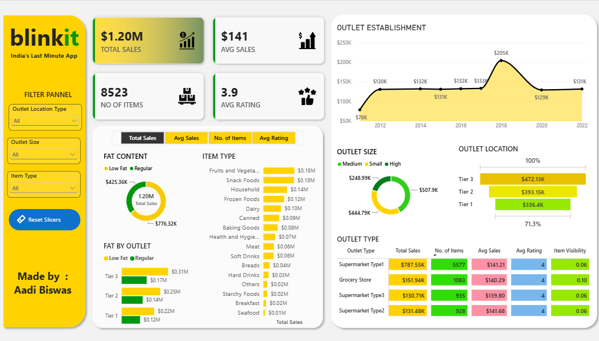

# 🟡 BlinkIt Sales Analytics | Power BI Dashboard


An interactive Power BI dashboard that analyses **8,500+ BlinkIt grocery sales records** by item category, outlet type, outlet size, location tier and establishment year, with KPI cards, slicers and DAX measures.



---

## 📌 Table of Contents
- [Project Overview](#-project-overview)
- [Business Questions Answered](#-business-questions-answered)
- [Dataset](#-dataset)
- [Data Preparation](#-data-preparation)
- [Dashboard Features](#-dashboard-features)
- [Key Insights](#-key-insights)
- [Recommendations](#-recommendations)
- [Tools & Skills Used](#-tools--skills-used)
- [Repository Structure](#-repository-structure)
- [How to Use](#-how-to-use)
- [Future Improvements](#-future-improvements)
- [Author](#-author)

---

## 📖 Project Overview
BlinkIt is a quick-commerce grocery platform. This project turns raw outlet and item-level sales data into a one-page dashboard so a business user can see **how much is sold, where, and of what**, and filter the view in a few clicks.

**Goal:** help stakeholders understand which item types, outlet tiers and outlet formats drive sales, and how ratings and item visibility relate to them.

## ❓ Business Questions Answered
- What are the total sales, average sales per item and average customer rating?
- Which item categories generate the most sales?
- Which outlet location tier (Tier 1 / 2 / 3) performs best?
- How do sales differ by outlet size and outlet type?
- How does fat content (Low Fat vs Regular) split across outlet tiers and sizes?
- How do sales vary by outlet establishment year?

## 📂 Dataset
**File:** [`data/BlinkIT_Grocery_Data.xlsx`](data/BlinkIT_Grocery_Data.xlsx): **8,523 rows × 12 columns**, 10 outlets, 16 item categories.

| Column | Description |
|---|---|
| Item Identifier | Unique product ID |
| Item Type | Product category (Fruits and Vegetables, Snack Foods, Household, Dairy, etc.) |
| Item Fat Content | Low Fat / Regular |
| Item Weight | Weight of the product |
| Item Visibility | Share of the outlet's display area given to the product |
| Outlet Identifier | Unique outlet ID |
| Outlet Establishment Year | Year the outlet opened |
| Outlet Size | Small / Medium / High |
| Outlet Location Type | Tier 1 / Tier 2 / Tier 3 |
| Outlet Type | Grocery Store / Supermarket Type1 / Type2 / Type3 |
| Sales | Sales amount |
| Rating | Customer rating (1 to 5) |

## 🧹 Data Preparation
- `Item Fat Content` had inconsistent labels (`LF`, `low fat`, `reg`, `Low Fat`, `Regular`), standardised into two clean values: **Low Fat** and **Regular**.
- `Item Weight` has 1,463 missing values (about 17% of rows). It is not used in any sales measure, so these rows were kept.
- No missing values in `Sales`, `Rating`, or any outlet column.

## 📊 Dashboard Features
**KPI cards:** Total Sales, Average Sales, Number of Items, Average Rating

**Visuals**

| Visual | Chart type |
|---|---|
| Total sales by Item Type | Bar chart |
| Total sales by Outlet Establishment Year | Line chart |
| Sales share by Fat Content | Donut chart |
| Sales by Outlet Size and Fat Content | Donut chart |
| Sales by Outlet Location Type | Funnel chart |
| Fat Content across Outlet Location Types | Clustered bar chart |
| Outlet Type summary (Total Sales, Avg Sales, No. of Items, Avg Rating, Item Visibility) | Table |

**Interactivity:** dropdown slicers for Outlet Location Type, Item Type and Outlet Size, a metric selector that switches the measure shown in the charts, and a **Reset Slicers** button.

**Design:** custom yellow theme with a custom KPI background and icons.

## 💡 Key Insights
- **Overall:** about **1.20M** in total sales from **8,523** items, with an average sale of about **141** and an average rating of about **3.97**.
- **Top categories:** Fruits and Vegetables (~178K) and Snack Foods (~175K) lead, followed by Household (~136K) and Frozen Foods (~119K). Seafood and Breakfast are the smallest.
- **Location tier:** Tier 3 outlets contribute the most sales (~472K, 39%), ahead of Tier 2 (~393K, 33%) and Tier 1 (~336K, 28%).
- **Outlet type:** Supermarket Type1 accounts for about **66%** of total sales (~788K). Type2, Type3 and Grocery Stores each contribute roughly 11 to 13%.
- **Outlet size:** Medium outlets lead (~42%), then Small (~37%) and High (~21%).
- **Fat content:** Low Fat items make up about **65%** of sales and Regular about 35%.
- **Volume, not price, drives the differences:** average sale per item is almost the same (~140 to 142) across every tier, size and outlet type, so the groups with higher sales simply sell more items. Ratings are also very similar (about 3.95 to 3.99) everywhere.
- **Outlet age:** the outlet established in 2018 has the highest sales (~205K, 17%) and the 2011 outlet the lowest (~78K), mostly because of the number of items sold.

## ✅ Recommendations
- Prioritise stock and promotions for **Fruits and Vegetables, Snack Foods and Household**, which together drive a large share of sales.
- Look at what makes **Supermarket Type1** and **Tier 3** outlets sell more items, and test whether it can be replicated in Tier 1 outlets.
- Since price per item and ratings are flat across groups, growth is more likely to come from **increasing the number of items sold** than from changing item value.

## 🛠 Tools & Skills Used
- **Power BI Desktop**: data modelling, visuals, slicers, themes, custom design
- **DAX**: measures for Total Sales, Average Sales, No. of Items and Average Rating
- **Power Query**: data cleaning and transformation
- **Excel**: source data

## 🗂 Repository Structure
```
blinkit-sales-analytics-powerbi/
├── README.md
├── data/
│   └── blinkit_grocery_data.xlsx
├── dashboard/
│   └── blinkit_sales_dashboard.pbix
└── images/
    └── dashboard_preview.png
```

## ▶️ How to Use
1. Clone this repository
   ```bash
   git clone https://github.com/<your-username>/blinkit-sales-analytics-powerbi.git
   ```
2. Install [Power BI Desktop](https://powerbi.microsoft.com/desktop/) (free, Windows only).
3. Open `dashboard/blinkit_sales_dashboard.pbix`.
4. If Power BI shows a data source error: **Home → Transform data → Data source settings → Change Source**, and point it to `data/BlinkIT_Grocery_Data.xlsx` on your machine.
5. Use the slicers and the **Reset Slicers** button to explore the data.

## 🚀 Future Improvements
- Add a second page with a deeper look at item visibility versus sales.
- Add year-over-year or time-based analysis if date-level data becomes available.
- Publish to Power BI Service and add a public link.

## 👤 Author
**Aadi Biswas**\
IIT (ISM) Dhanbad
